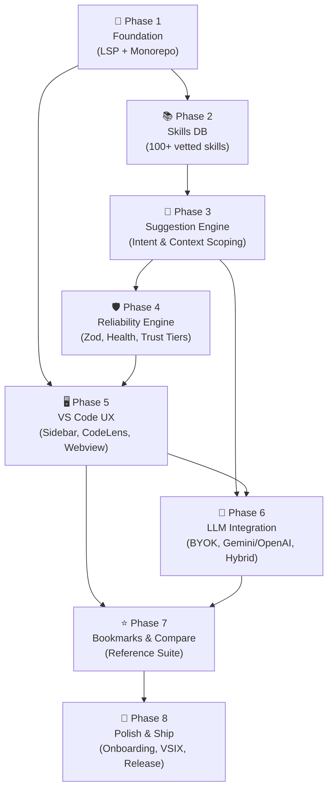

# ROADMAP.md

> **Current Phase**: Not started
> **Milestone**: v1.0 — SkillForge MVP
> **Target**: Cross-IDE skill suggestion engine with beginner-first UX, multi-tiered reliability, and user-controlled context scoping.

## Must-Haves (from SPEC)

- [x] Monorepo with pnpm workspaces + Turborepo + LSP server booting cleanly
- [x] 100+ curated skills database with categories, relationships, and metadata validation
- [x] Suggestion engine with natural language intent parsing and scoped workspace dependency scanning
- [ ] Reliability engine with Zod schema contracts, package existence checks, health indicators, and trust tiers
- [ ] VS Code UX with Command Palette, Sidebar (including context folder selector), and inline CodeLens triggers
- [ ] Interactive Webview results panel with skill cards, "WHY" explanations, and trust badges
- [ ] BYOK LLM integration (OpenAI-compatible & Gemini) securely using SecretStorage with optional Validator mode
- [ ] Duplicate query detection, "already installed" detection, and graceful fallback cascade
- [ ] Bookmarks persistence (globalState) and side-by-side technology comparison mode
- [ ] First-run onboarding walkthrough, strict Webview CSP, and clean VSIX packaging

---

## 8-Phase Roadmap

### Phase 1: Foundation — LSP Server & Monorepo Scaffold
**Status**: ✅ Complete
**Objective**: Establish pnpm monorepo structure, shared TypeScript build system, Vitest test harness, and a minimal headless LSP server that boots over stdio and responds to custom `skillforge/suggest` requests with client roundtrip validation.
**Deliverables**:
- Monorepo packages: `packages/server`, `packages/vscode-client`, `packages/shared`
- Shared protocol contracts and request/response types
- LSP server lifecycle handlers (`initialize`, `shutdown`, `exit`, error recovery)
- Basic VS Code client activation testing server connectivity
- Vitest configuration and base integration test
**Requirements**: Foundation for all phases
**Depends on**: Nothing

### Phase 2: Skills Database & Schema — The Knowledge Base
**Status**: ✅ Complete
**Objective**: Build a typed, validated, and queryable database of 100+ developer skills and technologies across major engineering domains with relationships and indicators.
**Deliverables**:
- TypeScript schema and Zod validation for `Skill`, `Category`, `Relationship`
- Curated seed database (100+ skills: Web Frontend, Backend, Databases, Mobile, DevOps, Testing, Security)
- Skill relationship graph (alternatives, works-with, prerequisites)
- Automated build-time validation script and search indexing structure
**Requirements**: REQ-Knowledge
**Depends on**: Phase 1

### Phase 3: Suggestion Engine & Context Scoping
**Status**: ✅ Complete
**Objective**: Implement the core matching engine that merges natural language intent with user-scoped workspace dependencies to generate ranked skill suggestions.
**Deliverables**:
- Natural language intent parser & keyword extractor
- Fuzzy tag matching and multi-factor relevance scorer
- Scoped workspace scanner supporting root or specific folder paths (`package.json`, `requirements.txt`, `go.mod`, `Cargo.toml`, etc.)
- Active file signal extractor (open editor tabs and nearby imports)
- In-memory query caching and duplicate query detection
**Requirements**: REQ-Engine, REQ-Context
**Depends on**: Phase 2

### Phase 4: Reliability Engine & Trust Verification
**Status**: ⬜ Not Started
**Objective**: Build the multi-tiered verification pipeline to eliminate hallucinations, detect abandoned packages, verify ecosystem compatibility, and assign transparent trust tiers.
**Deliverables**:
- Zod schema validator for all incoming and generated suggestions
- Ground-truth cross-referencer against the vetted Phase 2 database
- Package registry existence checker & health verification (npm registry / GitHub metrics with caching)
- Trust tier scoring & classification engine (🟢 Verified, 🟡 Validated, 🟠 Suggested, ⛔ Deprecated)
- Conflict and alternative detection ("pick one, not both")
- Fallback cascade orchestrator (LLM → Local DB → Category Browser)
**Requirements**: REQ-Reliability, REQ-Fallbacks
**Depends on**: Phase 3

### Phase 5: VS Code Client UX — Entry Points & Webview Panel
**Status**: ⬜ Not Started
**Objective**: Build the complete user-facing frontend in VS Code: Command Palette, Sidebar with context scope selector, inline CodeLens, and rich Webview results panel with strict security.
**Deliverables**:
- Command Palette quick-query flow (`SkillForge: Suggest Skills`)
- Sidebar treeview panel with context scope dropdown, recent queries, and stack overview
- CodeLens provider for `// IDEA:` and `// SKILL:` comments with debouncing
- Secure Webview results panel with strict Content Security Policy (CSP) and nonces
- Interactive skill cards displaying trust badges, difficulty, "WHY" explanations, and health signals
- Context selector allowing users to toggle between entire workspace and specific subfolders
**Requirements**: REQ-UI, REQ-Security
**Depends on**: Phase 1, Phase 4

### Phase 6: LLM Providers & BYOK Integration
**Status**: ⬜ Not Started
**Objective**: Implement pluggable Bring-Your-Own-Key LLM support with OpenAI-compatible and Gemini endpoints, secure key storage, hybrid result merging, and optional dual-pass validation.
**Deliverables**:
- `SuggestionProvider` interface abstraction
- `LocalProvider`, `OpenAICompatibleProvider`, and `GeminiProvider` implementations
- Secure API key management using VS Code `SecretStorage` (`context.secrets`)
- Hybrid mode: instantaneous local results (<300ms) with seamless AI enhancement merging (~2-3s)
- Optional Generator-Validator mode (LLM generates → validator verifies applicability)
- System prompts with few-shot examples and strict schema outputs
**Requirements**: REQ-LLM, REQ-BYOK
**Depends on**: Phase 3, Phase 5

### Phase 7: Bookmarks, Comparison & Reference Suite
**Status**: ⬜ Not Started
**Objective**: Build productivity and decision-making features: persistent skill bookmarks, side-by-side alternative comparison matrix, and query history management.
**Deliverables**:
- Skill bookmarking system persisted across sessions via `globalState`
- Bookmarks sidebar view grouped by category with one-click access
- Side-by-side technology comparison panel (comparing up to 3 skills across difficulty, learning curve, ecosystem, and health)
- Query history view with one-click re-run capability
**Requirements**: REQ-Bookmarks, REQ-Comparison
**Depends on**: Phase 5, Phase 6

### Phase 8: Polish, Onboarding & Marketplace Release
**Status**: ⬜ Not Started
**Objective**: Finalize product readiness: interactive first-run walkthrough, graceful error notifications, performance optimization, accessibility audit, documentation, and VSIX packaging.
**Deliverables**:
- First-launch interactive walkthrough introducing trigger mechanisms
- Actionable error states (offline mode, invalid API keys, empty queries, category browser fallback)
- Performance & bundle optimization with `esbuild` (<500ms activation, <5MB VSIX)
- Extension icon (PNG ≥128x128), comprehensive marketplace `README.md`, `CHANGELOG.md`, `LICENSE` (MIT + CC BY)
- Clean VSIX package generation (`vsce package`) and local installation verification
**Requirements**: REQ-Release, REQ-Performance
**Depends on**: Phase 7

---

## Phase Dependency Graph

