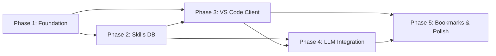

# ROADMAP.md

> **Current Phase**: Not started
> **Milestone**: v1.0 — SkillForge MVP
> **Target**: Cross-IDE skill suggestion engine with beginner-first UX

## Must-Haves (from SPEC)

- [ ] LSP server starts and responds to skill suggestion requests
- [ ] VS Code extension connects to LSP with 3 entry points (command palette, sidebar, inline comments)
- [ ] Local curated skills database returns relevant suggestions
- [ ] At least one LLM provider (Gemini) integration as configurable backend
- [ ] Workspace scanning detects existing project stack
- [ ] Skill bookmarks persist across sessions
- [ ] Comparison mode for 2-3 technologies side by side
- [ ] Extension installs cleanly (VSIX or marketplace)

---

## Phases

### Phase 1: Foundation — LSP Server & Project Scaffold
**Status**: ⬜ Not Started
**Objective**: Set up the monorepo structure, TypeScript build system, and a minimal LSP server that starts, handles `initialize`, and responds to a custom `skillforge/suggest` request with a hardcoded response.
**Deliverables**:
- Monorepo with `packages/lsp-server`, `packages/vscode-client`, `packages/shared`
- LSP server boots and handles lifecycle (initialize, shutdown, exit)
- Custom `skillforge/suggest` request/response protocol defined in shared types
- Basic test harness for the LSP server
**Requirements**: Foundation for all other phases
**Depends on**: Nothing

### Phase 2: Skills Database & Suggestion Engine
**Status**: ⬜ Not Started
**Objective**: Build the local curated skills database and the core suggestion algorithm that matches user intent to relevant technologies.
**Deliverables**:
- JSON-based skills database schema (name, category, difficulty, description, learnUrls, tags, ecosystem)
- Curated database seeded with 100+ skills across major domains (web, mobile, backend, data, DevOps, etc.)
- Fuzzy matching engine: keyword extraction → tag matching → relevance scoring
- Workspace scanner: reads `package.json`, `requirements.txt`, `go.mod`, `Cargo.toml`, `pom.xml`, etc.
- Suggestion pipeline: user intent + workspace context → ranked skill list
**Requirements**: REQ-03, REQ-04, REQ-05
**Depends on**: Phase 1 (LSP protocol types)

### Phase 3: VS Code Client — Multi-Entry-Point UX
**Status**: ⬜ Not Started
**Objective**: Build the VS Code extension client with all three entry points and a rich Webview-based results panel.
**Deliverables**:
- Command palette command: "SkillForge: Suggest Skills for My Idea"
- Sidebar panel: dedicated input with recent queries
- Inline comment detection: CodeLens for `// IDEA: ...` or `// SKILL: ...` comments
- Webview results panel: skill cards with name, category, difficulty badge, description, learning links
- Extension settings: configure backend (local/LLM/hybrid), API keys, preferred difficulty level
**Requirements**: REQ-01, REQ-02, REQ-06
**Depends on**: Phase 1 (LSP client connection), Phase 2 (suggestion engine)

### Phase 4: LLM Integration & Configurable Backends
**Status**: ⬜ Not Started
**Objective**: Add LLM-powered suggestions as a configurable backend, with Gemini as the first provider, and a clean provider abstraction for future additions.
**Deliverables**:
- `SuggestionProvider` interface: `suggest(intent: string, context: WorkspaceContext): Promise<Skill[]>`
- `LocalProvider` wrapping the curated DB engine from Phase 2
- `GeminiProvider` calling the Gemini API with structured output
- `HybridProvider` combining local + LLM results with deduplication and ranking
- Provider selection via extension settings (user configurable)
- API key management (secure storage via VS Code SecretStorage)
**Requirements**: REQ-03
**Depends on**: Phase 2 (local provider & types), Phase 3 (settings UI)

### Phase 5: Bookmarks, Comparison & Polish
**Status**: ⬜ Not Started
**Objective**: Add skill bookmarks, side-by-side comparison mode, and polish the overall experience for marketplace readiness.
**Deliverables**:
- Bookmark system: save/unsave skills, persisted in workspace or global storage
- Bookmarks panel: dedicated sidebar view showing saved skills
- Comparison mode: select 2-3 skills → side-by-side comparison table (pros/cons, difficulty, ecosystem, learning curve)
- Onboarding walkthrough: first-launch tutorial explaining features
- Error handling & edge cases: no results, API failures, malformed workspace files
- Extension icon, marketplace metadata, README, CHANGELOG
- VSIX packaging and local install verification
**Requirements**: REQ-05, REQ-06, REQ-07, REQ-08
**Depends on**: Phase 3 (Webview UI), Phase 4 (all providers working)

---

## Phase Dependency Graph

