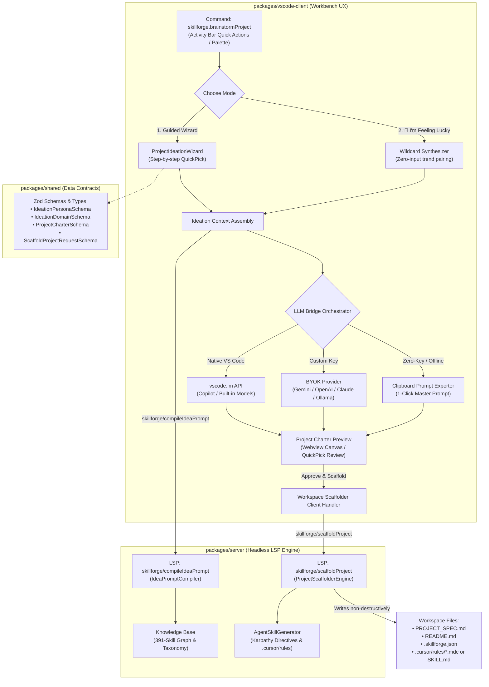

# 🌊 SkillForge Project Studio — Architecture & Flow

This document details the end-to-end architecture and runtime flow of the **SkillForge Project Studio & Ideation Scaffolder Engine** introduced in `v1.2.0`.

---

## 🏛️ System Architecture Diagram

---

## 🔄 Step-by-Step Execution Lifecycle

### 1. Trigger & Mode Selection
* User invokes `SkillForge: Brainstorm & Plan Project` via Command Palette (`Ctrl+Shift+P`), Activity Bar Quick Actions, or Webview button.
* User chooses between:
  1. **Guided Wizard**: Step-by-step adaptive questionnaire for tailored requirements.
  2. **🎲 I'm Feeling Lucky**: Instant wildcard pairing modern paradigms (e.g., eBPF, local embeddings, real-time WebSockets, WebAssembly) with real-world problems.

### 2. Adaptive Needs Discovery (Guided Wizard)
* **Step 1: Experience Persona**:
  * *Fresher / Student*: Emphasis on core fundamentals, resume appeal, manageable scope, and avoiding tutorial hell.
  * *Intermediate Developer*: Focus on robust architecture, auth, relational database modeling, and automated testing.
  * *Working Professional / Senior*: Focus on distributed systems, high throughput, novel agentic workflows, and production posture.
* **Step 2: Domain of Interest**: DevTools, FinTech, AI Agents, Real-Time Collab, Observability, Campus/Social, Open Source, or Custom.
* **Step 3: Preferred Language & Ecosystem**: TypeScript/Node, Python, Go, Rust, Java/Kotlin, C++, or Open to Recommendation.
* **Step 4: Time Budget & Scope**: Weekend Hackathon (8–12 hrs), 2-Week Deep Dive (20–40 hrs), or Production MVP (1+ months).
* **Step 5: Optional Goal / Twist**: Freeform constraints (e.g. *"Must use SQLite and WebSockets"*).

### 3. Contextual Prompt Compilation (`skillforge/compileIdeaPrompt`)
* The client sends the structured questionnaire answers to `@skillforge/server`.
* `IdeaPromptCompiler`:
  1. Prunes scope dynamically based on the time budget (e.g. actively preventing scope creep if the time budget is 8 hours).
  2. References SkillForge's **391-skill database** to anchor library recommendations in real, vetted packages.
  3. Formulates a JSON-enforcing system prompt requiring:
     * Project Title & Tagline
     * Problem Statement & Persona
     * The Technical Twist (what makes it stand out)
     * Recommended Tech Stack (mapped to SkillForge catalog IDs)
     * 3-Phase Milestone Roadmap (Phase 1 MVP, Phase 2 Core, Phase 3 Stretch)

### 4. LLM Bridge Orchestration
The client executes the compiled prompt through a resilient multi-tier fallback:
1. **Tier 1 (Zero-Config Native)**: Uses `vscode.lm` (VS Code's official Language Model API) if GitHub Copilot or any language model provider is active.
2. **Tier 2 (BYOK)**: Connects to custom OpenAI / Gemini / Claude / Ollama endpoints configured in `SecretStorage`.
3. **Tier 3 (Zero-Token Clipboard Fallback)**: If offline or no keys are present, copies the engineered master prompt directly to the user's clipboard and provides a 1-click import dialog for web AI output.

### 5. Project Charter Review
* The user inspects the structured charter:
  * Can click **🔄 Tweak Twist** to regenerate.
  * Can click **📋 Copy Master Prompt** to export.
  * Can click **🚀 Scaffold Workspace** to proceed.

### 6. Workspace Scaffolding (`skillforge/scaffoldProject`)
* Inspects workspace hygiene (verifies no existing files are destroyed).
* Writes non-destructive deliverables:
  * `PROJECT_SPEC.md`: Complete engineering charter with user stories and milestones.
  * `README.md`: Starter documentation with setup instructions.
  * `.skillforge.json`: Workspace configuration anchoring the chosen tech stack.
* Invocations of `AgentSkillGenerator` drop AI rule files (`SKILL.md` or `.cursor/rules/*.mdc`) so coding agents instantly inherit the architectural context!
