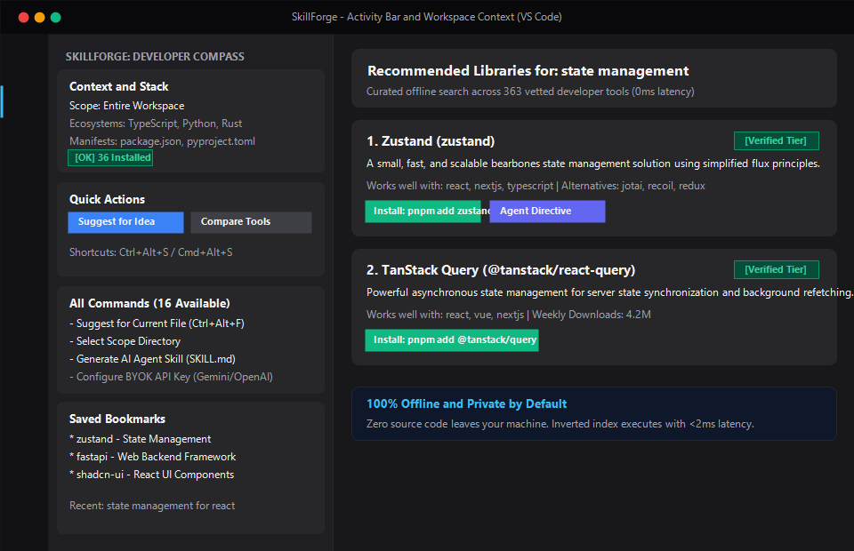
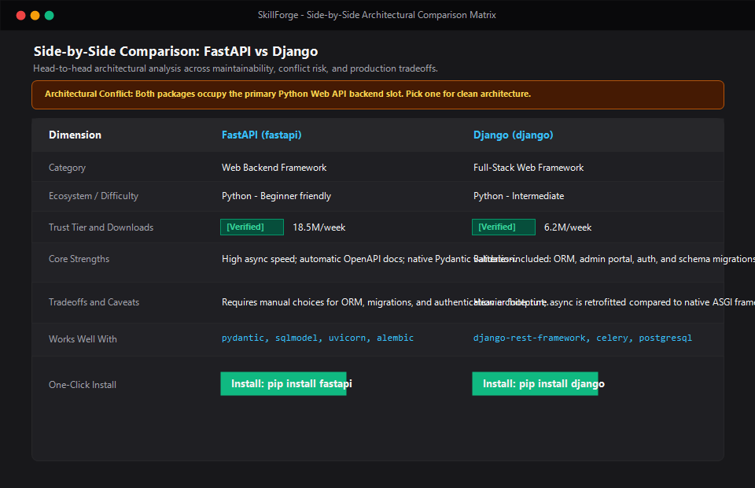
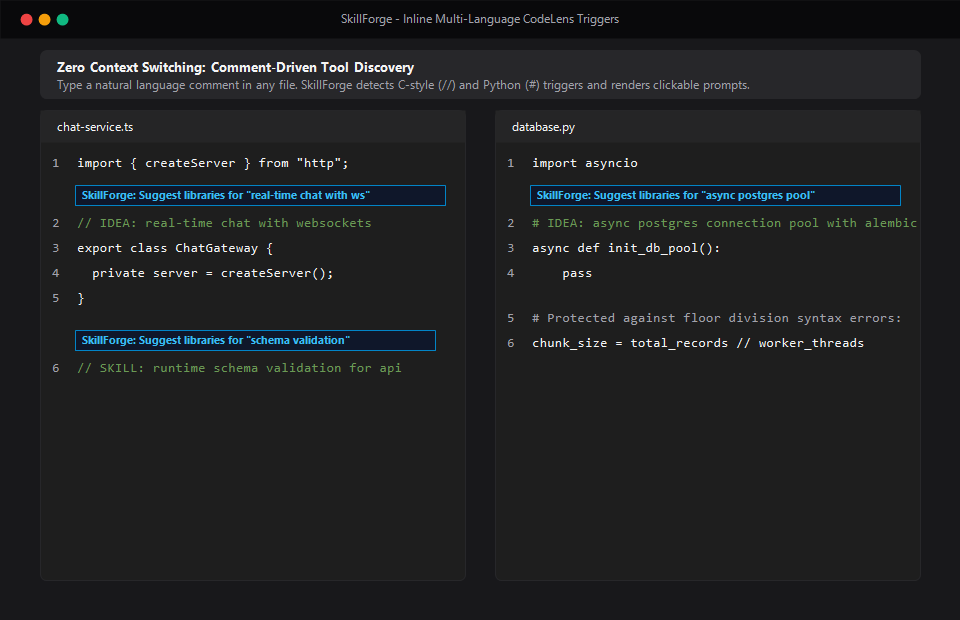
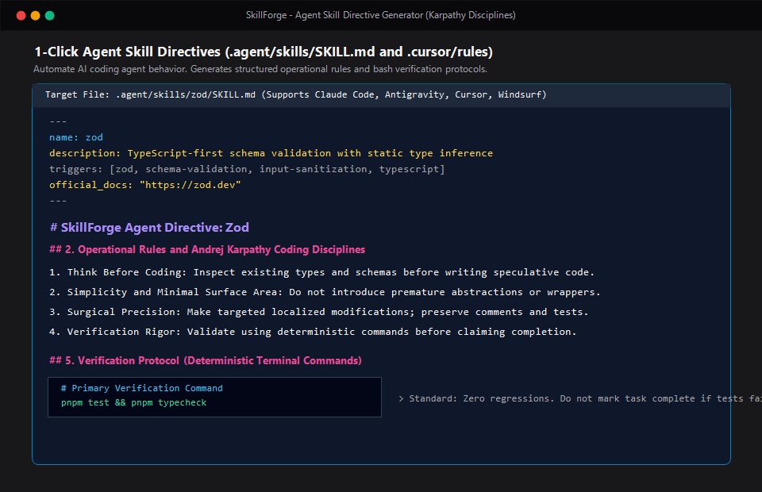

# SkillForge

[](https://open-vsx.org/extension/SkillForge/skillforge)
[](https://open-vsx.org/extension/SkillForge/skillforge)
[](LICENSE)
[](LICENSE)
[](#privacy--security-commitment)

> **Cross-IDE developer skill discovery engine: map natural language ideas to vetted libraries, frameworks, and architecture patterns.**

SkillForge acts as a developer's skill compass. When you have an idea for a feature or need to choose between competing libraries, SkillForge analyzes your intent and workspace context to recommend battle-tested tools with actionable learning paths, package health indicators, verified trust signals, and 1-click agent skill directives.

---

### ⚡ Quick Install

Launch VS Code Quick Open (`Ctrl+P` on Windows/Linux or `Cmd+P` on macOS), paste:

```bash
ext install SkillForge.skillforge
```

Or install directly from the **Extensions view** (`Ctrl+Shift+X` / `Cmd+Shift+X`) by searching for `SkillForge`.

---

## 📸 Visual Showcase

### 1. Activity Bar Sidebar & 5 Integrated Views
Auto-detects active workspace manifests, installed packages, and provides instant 1-click access to all commands and bookmarked tools.



---

### 2. Side-by-Side Comparison Matrix
Head-to-head comparison with architectural slot collision warnings, weekly downloads, maintenance health verdicts, and 1-click terminal install commands.



---

### 3. Inline CodeLens Comment Triggers
Zero context switching. Type a comment in your language's standard syntax (`//` for C-style, `#` for Python), and SkillForge displays a clickable CodeLens above it.



---

### 4. AI Coding Agent Directives (Andrej Karpathy Disciplines)
Generate structured `.agent/skills/<id>/SKILL.md` or `.cursor/rules/<id>.mdc` directives with strict YAML frontmatter, 4 non-negotiable coding disciplines (*Think Before Coding*, *Simplicity*, *Surgical Precision*, *Verification Rigor*), and deterministic verification commands.



---

## 🌟 Core Highlights

- **Intent-Based Discovery**: Describe what you want to build in plain English (e.g. *"real-time chat with WebSockets"*, *"fast async postgres ORM"*, *"declarative UI animations"*) and receive instant, ranked suggestions.
- **363 Curated, Purposeful Technologies**: An offline, in-memory knowledge base covering Web, Python, Mobile, AI/ML, Rust, Go, Java/JVM, DevOps, and Security. Every skill serves a concrete purpose with real package names, install commands, and verified docs.
- **100% Offline & Private by Default**: No code transmission, no cloud servers required, and zero telemetry. Queries execute locally in $<2\text{ms}$.
- **Battle-Tested Trust Seals**: Multi-tiered reliability with **Verified** and **Suggested** tiers, real npm/GitHub download metrics, and deprecation warnings.
- **Side-by-Side Comparison Matrix**: Compare 2 to 3 competing tools directly inside VS Code with architectural conflict warnings, pros, caveats, and companion chips.
- **Context & Monorepo Scoping**: Auto-discovers monorepo workspaces and lets you lock context to specific directories (`apps/web`, `packages/backend`).
- **Inline CodeLens Triggers**: Detects `// IDEA:`, `// SKILL:`, `# IDEA:`, and `# SKILL:` comments across 11 programming languages to suggest libraries without leaving your code editor.
- **One-Click Terminal Install**: Run exact package manager commands (`pnpm add`, `pip install`, `cargo add`, `go get`) in the scoped folder with a single click.
- **Optional BYOK Cloud AI**: Bring Your Own Key for OpenAI or Google Gemini. API keys are stored securely in your OS Keychain (`SecretStorage`).

---

## 🎯 Trigger Mechanisms & Syntax

SkillForge offers three distinct ways to discover tools:

### 1. Command Palette & Global Keybindings
- Press `Ctrl+Alt+S` (or `Cmd+Alt+S` on macOS) to open the interactive Suggestion Canvas for any idea.
- Press `Ctrl+Alt+F` (or `Cmd+Alt+F` on macOS) to suggest libraries tailored to the active file's technology stack.
- Press `Ctrl+Shift+P` (or `Cmd+Shift+P` on macOS) and type `SkillForge` to browse all 16 commands.

### 2. Activity Bar Sidebar
Click the **SkillForge Anvil Icon** in the VS Code Activity Bar on the left to access:
- **Context & Stack View**: Detected ecosystems, manifest files, and installed dependencies.
- **Quick Actions View**: One-click triggers for popular categories and comparisons.
- **All SkillForge Commands View**: 1-click execution for all 16 commands directly in the sidebar.
- **Recent Discoveries View**: Past query history with instant replay.
- **Bookmarks View**: Saved tools organized by category.

### 3. Inline CodeLens Comments
While coding, add an intent comment directly in your file:

**JavaScript, TypeScript, C, C++, C#, Java, Rust, Go:**
```typescript
// IDEA: user authentication with OAuth2 and sessions
// SKILL: high performance background job queue
```

**Python:**
```python
# IDEA: async postgres connection pool with alembic migrations
# SKILL: distributed task queue with redis
```

SkillForge renders an inline CodeLens prompt above the comment: `SkillForge: Suggest libraries for "..."`. Click it to inspect recommendations without context switching.

---

## 🌐 Supported Ecosystems & Manifest Detection

SkillForge automatically inspects workspace manifests to identify existing dependencies, filter suggestions to your language, and warn against conflicting libraries:

| Ecosystem / Language | Primary Extensions | Detected Manifest Files | Comment Trigger Syntax | Default Package Managers |
| :--- | :--- | :--- | :--- | :--- |
| **TypeScript** | `.ts`, `.tsx` | `package.json`, `tsconfig.json` | `// IDEA:`, `// SKILL:` | `pnpm`, `npm`, `yarn`, `bun` |
| **JavaScript** | `.js`, `.jsx`, `.mjs` | `package.json`, `jsconfig.json` | `// IDEA:`, `// SKILL:` | `pnpm`, `npm`, `yarn`, `bun` |
| **Python** | `.py` | `pyproject.toml`, `requirements.txt`, `Pipfile`, `setup.py` | `# IDEA:`, `# SKILL:` | `pip`, `poetry`, `uv`, `conda` |
| **Rust** | `.rs` | `Cargo.toml`, `Cargo.lock` | `// IDEA:`, `// SKILL:` | `cargo add` |
| **Go** | `.go` | `go.mod`, `go.sum` | `// IDEA:`, `// SKILL:` | `go get` |
| **Java / JVM** | `.java` | `pom.xml`, `build.gradle`, `build.gradle.kts` | `// IDEA:`, `// SKILL:` | `mvn`, `gradle` |
| **C / C++** | `.c`, `.cpp`, `.h`, `.hpp` | `CMakeLists.txt`, `Makefile`, `vcpkg.json`, `conanfile.txt` | `// IDEA:`, `// SKILL:` | `vcpkg`, `conan` |
| **C# (.NET)** | `.cs` | `*.csproj`, `*.sln`, `Directory.Build.props` | `// IDEA:`, `// SKILL:` | `dotnet add package` |

---

## ⌨️ Command Palette & Keybinding Reference

| Command Label | Command Identifier | Default Shortcut | Description |
| :--- | :--- | :--- | :--- |
| **SkillForge: Suggest Skills for My Idea** | `skillforge.suggest` | `Ctrl+Alt+S` / `Cmd+Alt+S` | Opens prompt to search 363 vetted tools for any feature idea. |
| **SkillForge: Suggest for Current File** | `skillforge.suggestForCurrentFile` | `Ctrl+Alt+F` / `Cmd+Alt+F` | Suggests companion libraries based on the active file's technology. |
| **SkillForge: Compare Skills Side-by-Side** | `skillforge.compareSkills` | — | Compares 2-3 tools with trade-offs, health metrics, and conflict warnings. |
| **SkillForge: Select Scope Directory** | `skillforge.selectScope` | — | Locks context scoping to a subpackage or monorepo folder. |
| **SkillForge: Rescan Workspace** | `skillforge.rescanWorkspace` | — | Forces a fresh scan of project manifests and dependencies. |
| **SkillForge: Open Suggestion Canvas** | `skillforge.showCanvas` | — | Reopens the rich interactive Suggestion Canvas webview. |
| **SkillForge: Generate Agent Skill** | `skillforge.generateAgentSkill` | — | Emits Karpathy-disciplined `SKILL.md` or `.cursor/rules/*.mdc` directives. |
| **SkillForge: Run Install Command in Terminal** | `skillforge.runInstallCommand` | — | Runs the library install command in your VS Code terminal. |
| **SkillForge: Bookmark / Unbookmark Tool** | `skillforge.toggleBookmark` | — | Saves or removes a library from your persistent bookmarks sidebar. |
| **SkillForge: Clear Saved Bookmarks** | `skillforge.clearBookmarks` | — | Clears all bookmarked tools. |
| **SkillForge: Clear Recent Discoveries** | `skillforge.clearRecentQueries` | — | Clears recent search query history. |
| **SkillForge: Save Cloud AI API Key** | `skillforge.setApiKey` | — | Saves personal Google Gemini or OpenAI key in OS Keychain. |
| **SkillForge: Remove Saved AI API Key** | `skillforge.clearApiKey` | — | Securely deletes stored API key from OS Keychain. |
| **SkillForge: Switch Search Engine Mode** | `skillforge.configureProvider` | — | Switches between 100% Offline Local, Google Gemini, and OpenAI. |
| **SkillForge: Configure AI Model** | `skillforge.configureModel` | — | Selects from free, paid flagship, reasoning, or any custom model ID. |
| **SkillForge: Open Getting Started Walkthrough** | `skillforge.openWalkthrough` | — | Opens interactive 5-step visual guide. |
| **SkillForge: Test Server Connection** | `skillforge.testConnection` | — | Verifies headless LSP server health and response latency. |

---

## ⚙️ Configuration Settings

Customize SkillForge behavior in VS Code Settings (`Ctrl+,` or `Cmd+,` $\to$ search `skillforge`):

| Setting | Type | Default | Description |
| :--- | :--- | :--- | :--- |
| `skillforge.provider` | `string` | `"local"` | Suggestion provider: `"local"` (100% offline, zero network traffic), `"gemini"`, or `"openai"` (BYOK AI enrichment). |
| `skillforge.maxResults` | `number` | `5` | Maximum number of ranked recommendations to return (1-20). |
| `skillforge.defaultDifficulty` | `string` | `"all"` | Target difficulty tier: `"all"`, `"beginner"`, `"intermediate"`, `"advanced"`. |
| `skillforge.timeoutMs` | `number` | `4000` | Timeout in milliseconds for optional BYOK AI requests before falling back to local catalog. |
| `skillforge.gemini.model` | `string` | `"gemini-2.0-flash"` | Model identifier for Google Gemini. Accepts free tier (`gemini-2.0-flash`), paid flagship (`gemini-1.5-pro`), or any custom model ID. |
| `skillforge.gemini.endpoint` | `string` | `""` | Custom Google Gemini API endpoint. |
| `skillforge.openai.model` | `string` | `"gpt-4o-mini"` | Model identifier for OpenAI-compatible endpoints. Accepts base tier (`gpt-4o-mini`), paid flagship (`gpt-4o`), reasoning (`o3-mini`, `o1`), or custom proxy models. |
| `skillforge.openai.endpoint` | `string` | `""` | Custom OpenAI-compatible API endpoint (defaults to official API). |

---

## 🔒 Privacy & Security Commitment

1. **Zero Source Code Transmission**: SkillForge never reads, parses, or transmits your application source code, file contents, or Git commit history.
2. **Local Execution**: All 363 skills reside in an in-memory inverted index bundled directly within the extension.
3. **OS Keychain Secret Storage**: API keys are stored exclusively in your operating system's native keychain (Windows Credential Manager, macOS Keychain, Linux Secret Service).
4. **Content Security Policy (CSP)**: The Suggestion Canvas Webview enforces strict nonces and disallows external unsafe scripts.

---

## 📜 License & Legal Attribution (NOTICE)

SkillForge is dual-licensed to protect both the software engine and the community-curated knowledge base:

- **Extension Code & Language Server**: Licensed under the **[MIT License](LICENSE)**. Copyright (c) 2026 AugustyaB.
- **Curated Skills Knowledge Base (`skills.json`)**: Licensed under the **[Creative Commons Attribution 4.0 International (CC BY 4.0)](LICENSE)**.

### Attribution Notice for Derivative Works
If you use, fork, or embed the SkillForge 363-technology catalog in your own AI models, datasets, or developer tools, you must provide attribution as follows:
> *"Includes technology metadata and architectural conflict relationships from the SkillForge Skills Database (https://github.com/AugustyaB/SkillForge), licensed under CC BY 4.0."*

---

## 🤝 Contributing & Bug Reports

- **GitHub Repository**: [https://github.com/AugustyaB/SkillForge](https://github.com/AugustyaB/SkillForge)
- **Issue Tracker & Feature Requests**: [https://github.com/AugustyaB/SkillForge/issues](https://github.com/AugustyaB/SkillForge/issues)
- **Open VSX Marketplace**: [https://open-vsx.org/extension/SkillForge/skillforge](https://open-vsx.org/extension/SkillForge/skillforge)
